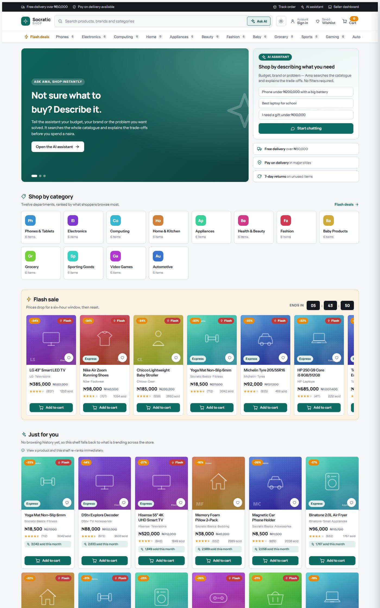
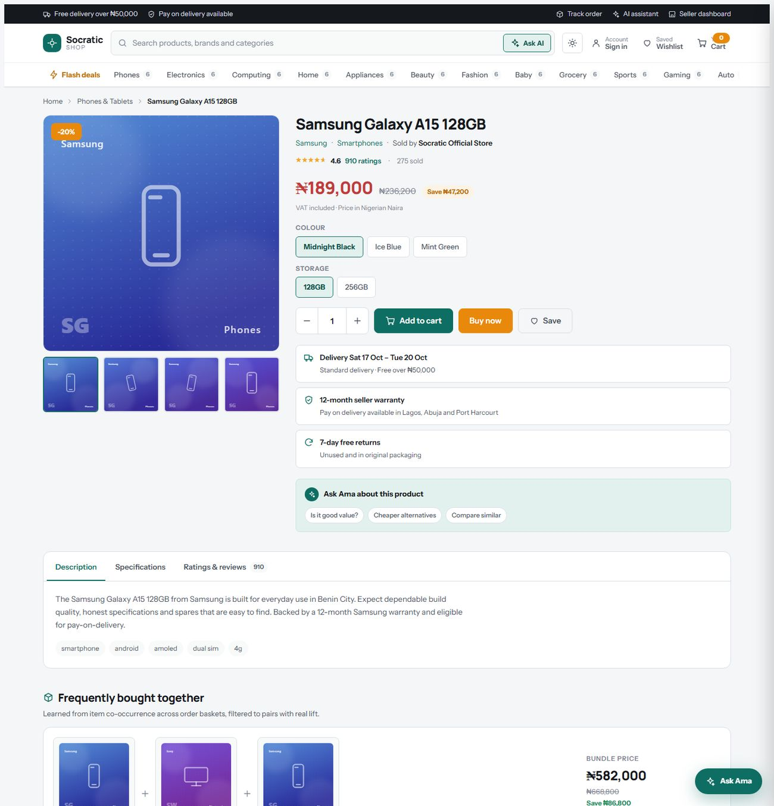
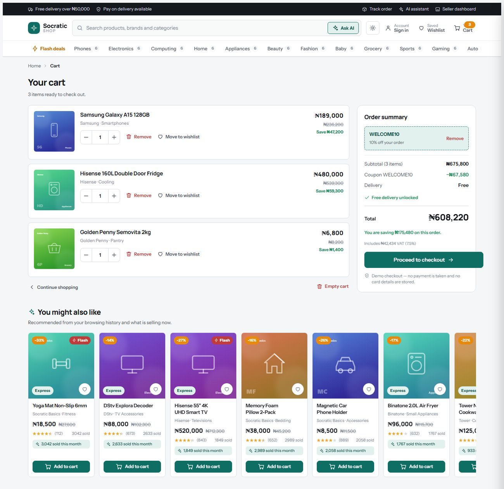
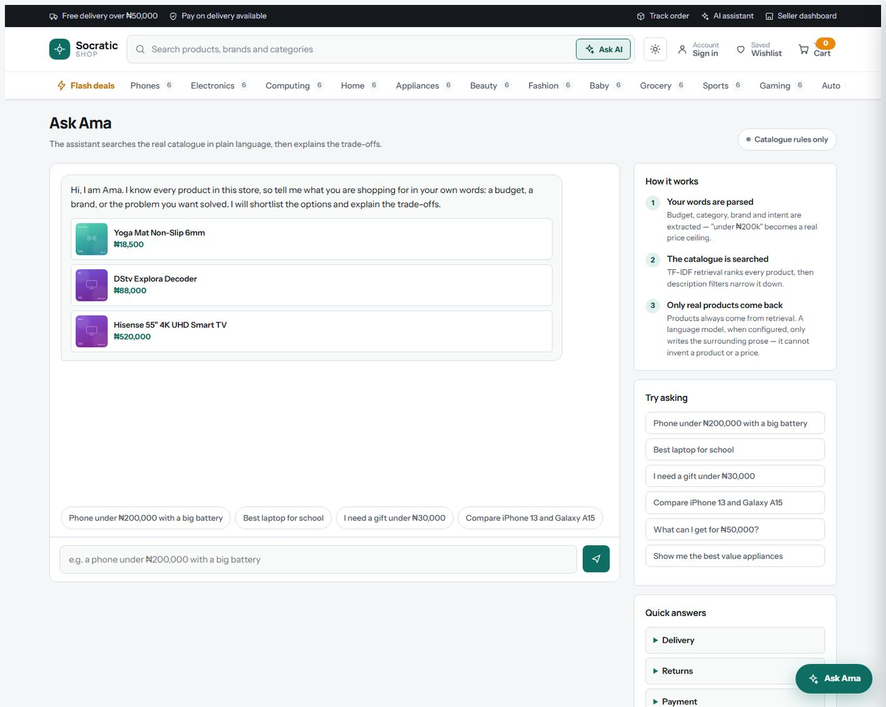

# Socratic Shop

A Jumia-style marketplace storefront with an AI shopping assistant, built as a Flask
blueprint inside an existing commerce-analytics application.

The storefront is the new part: a browsable 12-department catalogue, search with
facets, cart and checkout, and an assistant that answers plain-language shopping
questions. The recommendation and assistant layers are implemented from scratch —
TF-IDF, item-to-item collaborative filtering and a Bayesian rating prior in plain
Python, with no scikit-learn.



---

## Why this exists

The repository started as an analytics dashboard for a WooCommerce store: order
roll-ups, UTM campaign attribution, churn and lapsed-customer targeting. This project
adds the thing that dashboard never had — a **customer-facing storefront** — and
connects the two stories: the same order data that powers the analytics also trains
the recommender behind the shop.

The dashboard still works and was left untouched. The storefront lives at `/shop` as a
self-contained blueprint with its own templates, static assets, catalogue and engine,
so it can be lifted into another Flask app on its own.

| | |
|---|---|
|  |  |

---

## The assistant



The core design rule: **retrieval decides which products are shown; language models
only ever write the prose around them.** An assistant that invents a product or a price
is worse than no assistant at all, so the catalogue is the single source of truth and
the model is handed a fixed shortlist it is told not to extend.

Two tiers:

* **Tier 1 — always on, no API key, no cost.** Deterministic intent and entity parsing,
  then TF-IDF retrieval over the catalogue.
  * Intents: greeting, help, product search, recommend, compare, gift, budget, delivery,
    returns, payment, warranty, order tracking.
  * Entities: budget ceilings and ranges (`under 200k`, `between 50k and 120k`,
    `₦150,000`, `1.5m`, `fifty thousand`), category, brand and ranking attributes
    (cheapest / highest rated / newest / gift).
  * Comparisons return a spec-by-spec table built from real catalogue fields.
* **Tier 2 — opt-in.** Set `SHOP_LLM_API_KEY` and a chat-completions model rewrites the
  answer around the *same* retrieved shortlist. Any failure — bad key, timeout, rate
  limit, malformed response — silently falls back to the Tier 1 wording. The assistant
  cannot break because of the model.

```
SHOP_LLM_API_KEY    enables Tier 2 (falls back to DEEPSEEK_API_KEY if unset)
SHOP_LLM_BASE_URL   default https://api.deepseek.com/v1
SHOP_LLM_MODEL      default deepseek-chat
SHOP_LLM_TIMEOUT    default 12 seconds
```

---

## The recommender

Four signals, blended per surface, each recommendation carrying a human-readable
`reason` — an unexplained shelf of products reads as noise, while "Because you viewed
Samsung Galaxy A15" tells the shopper why the page changed.

| Signal | Implementation | Powers |
|---|---|---|
| Content similarity | TF-IDF over product text, L2-normalised, cosine | "Similar products" |
| Collaborative filtering | Item-item cosine over order baskets, scored by lift | "Customers also bought", "Frequently bought together" |
| Bayesian rating prior | Shrinks a rating toward the catalogue mean by review count | "Highest rated" |
| Popularity × recency | Log-scaled sold/reviews with a recency decay | "Trending now" |

Two details that matter more than they look:

* **The rating prior.** 5.0 from two reviews must not outrank 4.6 from 900. Ratings are
  shrunk toward the catalogue mean with a weight of 25 reviews, so "Highest rated" cannot
  be gamed by tiny sample sizes.
* **Lift, not raw co-occurrence.** Best-sellers appear in more baskets than everything
  else, so ranking pairs by raw counts just recommends the best-seller list. Scoring by
  cosine over the item's user sets, then filtering bundles to pairs with lift > 1.0, is
  what produces "phone → headphones, tablet, laptop" instead of "phone → whatever sells most".

Route-level quality guards live in `recommender.py`: because the catalogue is small,
thin TF-IDF text can otherwise pair a phone with a shirt, so `similar()` searches the
product's own department and brand first and only tops up globally if that shelf is short.

---

## Storefront features

* **Home** — hero carousel, 12 category tiles, flash sale with a live countdown,
  personalised "Just for you", trending, highest rated, brand rail.
* **Search** — TF-IDF relevance with an exact-word fallback, facet sidebar (category,
  brand, price range and quick bands, rating, express, flash), sorting, pagination, and
  live autocomplete with keyboard navigation.
* **Product** — 4-angle generated gallery, variants, quantity stepper, delivery estimate,
  seller and warranty, specification table, review distribution, bayesian "frequently
  bought together" bundle, and three distinct recommendation shelves.
* **Cart & checkout** — slide-over cart, coupons (`WELCOME10`, `SAVE2000`, `FREESHIP`),
  free-delivery threshold with progress, express delivery, Nigerian VAT shown as included,
  three-step checkout with validation, and order confirmation with a status timeline.
* **Wishlist, order history, flash-deals page** and a full-page assistant.
* **UI/UX** — the storefront extends the parent app's "Second Order" brand system (teal,
  Manrope, cool neutrals) rather than fighting it, so the shop and the dashboard read as
  one product. Responsive from desktop to phone, full dark mode with no flash on load,
  reduced-motion support, focus-visible rings, ARIA labels, skip link, and a working
  no-JavaScript fallback: every cart action is a plain form post, and JavaScript only
  upgrades them to `fetch`.

---

## Project structure

```
app/
  shop/                        the storefront blueprint
    __init__.py                package entry, imports routes
    blueprint.py               the Blueprint object (mounted at /shop)
    routes.py                  pages + JSON API
    catalog.py                 loading, search, filtering, faceting
    ml.py                      TF-IDF, item-item CF, rating priors
    recommender.py             blends the signals, adds reasons
    assistant.py               intent/entity parsing, retrieval, optional LLM tier
    cart.py                    session cart, coupons, shipping, VAT
    state.py                   recently viewed, wishlist, placed orders
    art.py                     generated SVG product artwork
    reviews.py                 deterministic sample reviews
    serializers.py             one JSON shape for product cards
    categories.py              category metadata (label, hue, glyph)
    dataset/
      generate_catalog.py      builds the dataset deterministically
      products.json            72 products across 12 departments
      orders.json              420 synthetic order baskets
    templates/shop/            storefront templates
    static/shop.css|shop.js    design system and behaviour
  routes/, services/, templates/   the original analytics dashboard (unchanged)
tests/
  test_shop.py                 100 tests: ML maths, parsing, cart, every route
docs/screenshots/              images used in this README
```

---

## Getting started

```bash
python -m venv venv
source venv/bin/activate         # Windows: venv\Scripts\activate
pip install -r requirements.txt

flask run                        # dashboard at /
                                 # storefront at http://127.0.0.1:5000/shop
```

The storefront needs **no database and no network**: the catalogue is committed JSON and
product images are generated SVGs. The dashboard keeps its own SQLAlchemy database and
migrations.

### Tests

```bash
pip install pytest
python -m pytest tests/test_shop.py -q      # 100 passed
```

The suite covers the TF-IDF and collaborative-filtering maths, budget and intent
parsing, cart arithmetic and coupons, and asserts that every product page, every category
page and every API endpoint responds correctly.

### Regenerating the catalogue

```bash
python -m app.shop.dataset.generate_catalog
```

Output is deterministic — ratings, units sold, discounts and order baskets are derived
from a fixed seed or a hash of the product slug, so re-running never churns the diff.

---

## Deployment

The repository ships a `railway.toml` and a `Procfile` (`gunicorn wsgi:app`), so it
deploys to Railway as-is. Because the storefront is a blueprint on the same Flask app,
`/shop` is served by the same process as the dashboard.

Optional environment variables:

```
FLASK_KEY=...            session signing key (set this in production)
SHOP_LLM_API_KEY=...     enables model-written assistant prose
DATABASE_URL=...         dashboard database (Railway Postgres)
```

---

## Honest notes

* **The data is synthetic.** 72 products, 420 order baskets, and the reviews are all
  generated deterministically. No real people or transactions are represented.
* **No payment is taken.** Checkout validates, records the order in the signed session
  cookie and stops. Card details are never requested or stored.
* **Product images are generated.** Each product gets a deterministic SVG from its
  category hue and a vector glyph, so the repo stays text-only and never hotlinks a CDN.
  Set a product's `image` field in `products.json` to a URL to use real photography
  instead — `serializers.product_card()` prefers it and the templates fall back.
* **`prompt.env` and `prompt.txt` are git-ignored.** They are large generated prompt
  dumps from the original project and are treated as local scratch files.

---

## Possible next steps

* Move the catalogue from JSON into the database with an admin CRUD surface.
* Learn the content embeddings from order history instead of hand-weighted text fields.
* A/B the assistant's Tier 1 and Tier 2 answers and log which converts.
* Real payment integration (Paystack or Flutterwave) behind the existing checkout.
